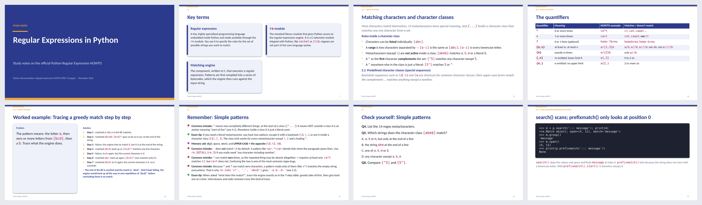
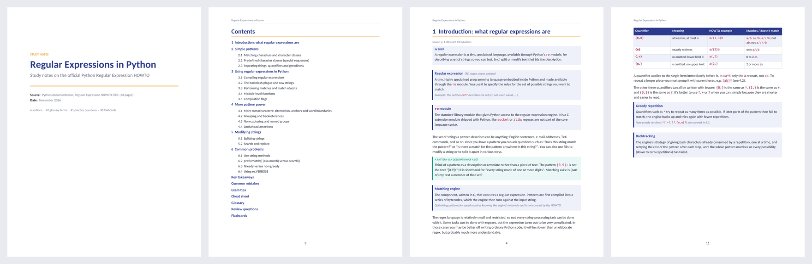
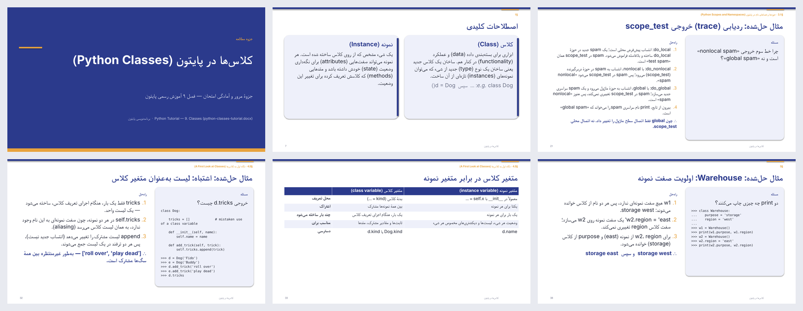

# 📚 study-notes — an agent skill for detailed study notes & review decks

Give your AI agent any learning resource — a **URL, PDF, textbook chapter, lecture slides, Word
doc, EPUB, YouTube video, Jupyter notebook or plain text** — and get back two polished files:

| | |
|---|---|
| **📄 Study notes (`.docx`)** | The complete reference for **learning**: cover, objectives, clickable contents, numbered sections with "In brief" summaries, definitions, worked examples with step-by-step solutions, formulas (LaTeX-rendered) with variable tables, code, comparison tables, diagrams (Mermaid), figures from the source, and callouts for key points, common mistakes, exam tips and memory aids. |
| **🖥️ Review deck (`.pptx`)** | A compact 16:9 deck for **reviewing**: section dividers, key-term cards, auto-fitted content (no overflowing text), worked-example and formula slides, a *Remember* slide and a *Check yourself* quiz per section — with speaker notes on every slide carrying the full explanation. |
| **🎯 Exam prep (in both)** | Key takeaways, common mistakes ✗ → ✓, exam tips, a one-page cheat sheet, glossary, 20–50 practice questions of mixed types and difficulty with a separate answer key, and flashcards. |

Right-to-left languages (Persian, Arabic, Hebrew, Urdu…) are laid out right-to-left automatically,
with code kept left-to-right. Notes are written in the language you ask in.





---

## Install

The skill lives in [`skills/study-notes/`](skills/study-notes). It follows the open
[Agent Skills](https://agentskills.io) format (`SKILL.md` + scripts), so it works with any agent
that can read a skill folder and run Python.

### Claude Code

```text
/plugin marketplace add xshyn/study-notes-skill
/plugin install study-notes@study-notes-skill
```

Or copy it in manually:

```bash
git clone https://github.com/xshyn/study-notes-skill
cp -r study-notes-skill/skills/study-notes ~/.claude/skills/        # all projects
# or: cp -r study-notes-skill/skills/study-notes .claude/skills/   # this project only
```

### Claude.ai / Claude desktop app

Download [`dist/study-notes.zip`](dist/study-notes.zip), then go to **Settings → Capabilities**,
scroll to **Skills** and click **Upload skill** (code execution and file creation must be enabled).
[`dist/study-notes.skill`](dist/study-notes.skill) is the same package for apps that install
`.skill` files directly.

### Codex, Cursor, Gemini CLI, OpenCode and other agents

```bash
curl -fsSL https://raw.githubusercontent.com/xshyn/study-notes-skill/main/install.sh | bash -s -- --agent codex
#   --agent claude | codex | cursor | gemini | opencode | agents | all
#   --project       install into ./.<agent>/skills instead of your home directory
#   --dir PATH      install into any skills directory your agent reads
```

If your agent has no skills directory, copy `skills/study-notes` anywhere and tell it:
*"Read `path/to/study-notes/SKILL.md` and follow it."*

### Requirements

- Python 3.9+ with `python-docx` and `python-pptx` (the installer runs
  `pip install -r skills/study-notes/requirements.txt`, which also adds optional extractors).
- Optional: **LibreOffice** (visual previews), **mermaid-cli** `mmdc` (diagram rendering).
  Everything degrades gracefully without them.

---

## Use

Just ask — the skill triggers on requests for notes, study guides, revision or exam material:

```text
Make detailed study notes from this PDF: lecture-05-transformers.pdf
I have a midterm on Monday — exam-prep notes and slides from https://en.wikipedia.org/wiki/TCP_congestion_control
Turn chapters 3–4 of this book (pages 70–130) into notes I can review from
از این فایل یه جزوه کامل فارسی برای امتحان درست کن، هم ورد هم پاورپوینت
```

Defaults (both files, `standard` depth, your language, indigo theme) are chosen automatically;
say *"exam"*, *"thorough"* or *"brief"* to change the depth, or name a theme
(`indigo`, `teal`, `crimson`, `slate`, `forest`, `plum`).

## How it works

```
source ─ extract_source.py ─▶ source.txt ─ (agent writes) ─▶ notes.json ─ validate_notes.py ─▶ fix gaps
                                                                │
                                   build_docx.py ◀──────────────┴──────────────▶ build_pptx.py
                                         └──────────── render_preview.py (visual QA) ────┘
```

1. **Extract** the full text with page/slide markers (PDF, DOCX, PPTX, EPUB, HTML, MD, IPYNB,
   subtitles, web pages, YouTube transcripts; falls back to the agent's own web tool when the
   sandbox blocks a URL).
2. **Write** one structured `notes.json`, guided by a pedagogy reference (fidelity to the source,
   coverage rules, question design, exam tips) and a strict schema.
3. **Validate** structure and **coverage against the source**: missing headings, uncovered pages,
   key-term coverage, thin sections, too few questions.
4. **Build** both files from the same JSON — layout is deterministic, so effort goes into content.
5. **Preview** as PDF + contact sheets and fix anything cramped or cut off.

The JSON format is documented in
[`references/notes_schema.md`](skills/study-notes/references/notes_schema.md).

---

## Benchmark

BENCHMARK_PLACEHOLDER

---

## Repository layout

```
skills/study-notes/
├── SKILL.md                    # the workflow the agent follows
├── references/
│   ├── notes_schema.md         # notes.json format
│   └── pedagogy.md             # how to write notes that teach
├── scripts/
│   ├── extract_source.py       # any source → text (+ figures)
│   ├── validate_notes.py       # structure + coverage checks
│   ├── build_docx.py           # notes.json → Word
│   ├── build_pptx.py           # notes.json → PowerPoint
│   ├── render_preview.py       # PDF + thumbnails + overflow check
│   └── notes_common.py
├── requirements.txt
└── evals/                      # benchmark cases (also runnable with `claude plugin eval`)
dist/study-notes.skill          # upload-ready package for Claude.ai
install.sh                      # multi-agent installer
.claude-plugin/                 # Claude Code plugin marketplace manifest
```

## License

MIT © Shayan ([@xshyn](https://github.com/xshyn))
